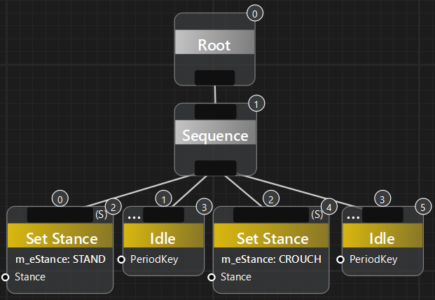
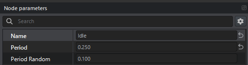
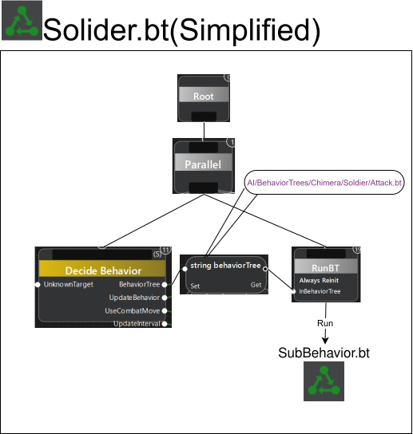

# Squat.btを作る
## Squat.btの新規作成
1. EnfusionWorkbenchウィンドウ(Workbenchを立ち上げ一番最初に開かれるウィンドウ)からBehaviorEditorを開く
2. BehaviorTreeを新規作成してSuqat.btという名前で保存します  
保存先フォルダ:`AI/BehaviorTrees/Chimera/Soldier`

## Squat.btの実装
立ちとしゃがみを一定周期で実行することでスクワットっぽい動作をさせてます  
  
IdleタスクのPeriodは0.25秒に設定しています  
  

## Squat.btの動作確認
Squat.btの動作確認の為、SquatManにSquat.btを実行させましょう   
SquatManのChimeraAICntroComponeetのパラメーターを以下のように設定します
- OvrrideAIBehaviorData  
	Squat.btに設定
- EnableAI  
	オン   

SquatManがひたすらしゃがみと立ちを繰り返していれば、正常に動作しています  

## Soldier.btからSquat.btを呼び出す
本来のSquatManが実行するSoldier.btでは、その実行中に任意のBehaviorTreeを呼び出すことができます。  
例えば、カバー、治療、移動　といった動作するBehaviorTreeをSolider.btの実行中に呼び出すことが出来ます。  
こうしたSoldier.btでのBehaviorTreeの呼び出しは、そのBehaviorTreeに対応する**Action**を生成し、AIに渡すことで実現します。   
この**Action**については、次節の  **AISquatBehaviorを作る**  で解説します


# AISqautBehaviorを作る
## Actionとは？
AIにおける「ToDo（やること）」のような概念です。  
人間がToDoリストに優先度をつけ、上から順番にタスクをこなしていくのと同様に、AIも内部のActionリストから、優先度の高いActionを順番に処理していきます。  
例として、移動(優先度20)と治療(優先度60)のアクションが与えられた場合、Heal,Moveの順で実行されます  
Actionに優先度があることで、移動する前に先ず治療をする、といったスマートなAIを実現しています  

## 新しいActionを作るには
新しいActionを作るには、SCR_AIBehaviorBaseを継承したクラスを実装します。  
実装にあっては、Actionが実行するBehaviorTreeへのパス、Actionの優先度 を設定する必要があります   
以下実装例
```
class TUT_AISquatBehavior:SCR_AIBehaviorBase{
    // This is priority of action. Its set between DEFEND(61) and SUPPRESS(63)
	const static float PRIORITY_BEHAVIOR_SQUAT = 62; 

	void TUT_AISquatBehavior(SCR_AIUtilityComponent utility, SCR_AIActivityBase groupActivity = null, float priority = PRIORITY_BEHAVIOR_SQUAT, float priorityLevel = PRIORITY_LEVEL_NORMAL){
        // Paste the path to the squat.bt file you created like this "{ABCDEFG12345}AI/BehaviorTrees/Chimera/Soldier/Squat.bt"
		m_sBehaviorTree = "{249D16A79333E117}sample/BehaviorTree/Squat.bt"; 
		SetPriority(priority);
		m_fPriorityLevel.m_Value = priorityLevel;
	}
}
```

## Soldier.btの概要
  
図1:兵士のAIAgentが実行するSoldier.btを簡素化した図  

最初にDecideBehaviorを呼び出し、実行すべきBehaviorTree(idle.btやattack.bt等)のパスを出力する。  
パス出力はRunBTの入力に繋がれ、RunBTが呼び出されることでパスのBehaviorTreeが実行される。 

- **SquatMan** 非武装のキャラクターエンティティ
- **ChimeraAIControlComponent** キャラクターをAIで動かすためのコンポーネント。AI本体であるAIAgentをスポーンさせる。  
- **AIAgent** 実際にBehaviorTreeを実行するAIの本体。  
