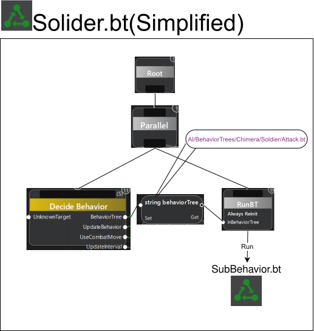

# 前提条件
Workbenchの基本的な操作方法  
EnfusionScriptの基本的な構文の理解  
BhaviorTreeの基本的な仕組みの理解  

# AIAgentの概要・動作原理
AIAgentとは兵士や分隊が自律的に状況を判断し、行動できるようにするための人工知能です。  
AIAgentはBehaviorTreeによって動作します。BehaviorTreeとはルーチンを木構造で表現したものです。  
AIAgentが標準で実行するBehaviorTreeでは、行動の決定と実行が以下の図のノードで実装されています。  

  
図1:兵士のAIAgentが実行するSoldier.btを簡素化した図  

最初にDecideBehaviorを呼び出し、実行すべきBehaviorTree(idle.btやattack.bt等)のパスを出力する。  
パス出力はRunBTの入力に繋がれ、RunBTが呼び出されることでパスのBehaviorTreeが実行される。  
GroupのAIGentはSoldier.btでなくGroup.btを実行するが、おおまかな動作は図と同様である。

# 解説 書きかけ
Message->Reaction->Action  

AIAgentに対し外部から送信される情報
## Message
　外部からAIAgentに伝わる情報という概念の抽象的な実装？  
　主にGoalMessage,InfoMessage,Orderの３つに分かれている  
　GoalMessage:達成目標が与えられるMessage？  
　InfoMessage:よくわかんないっぴ  
　Orders:主にプレイヤーがAI分隊に対して下す命令？
## Reaction
　AIAgentが引き起こす事のできる事前に定義されたAIAgentの振る舞い
　Reactionは大抵Actionを生成する。Actionを生成しない場合はなにもしなかったり、Actionではない別のシステムを利用した処理をすることもある。
## Action
　AIAgentが実行するBehaviorTreeのこと。BehaviorTreeそのものではない。  
　BeahviorTreeとの違いとして、Actionには優先度が設定されている  
　これにより複数のアクションがAIAgentに与えられた場合、どのActionを優先して実行すべきかAIAgentが判断できるようになる  
　例えばIdle,Move,HealだとHeal>Move>Idleの順で優先度が設定されているので、出血したら移動より治療を優先して実行する、といった振る舞いを実現できる  
